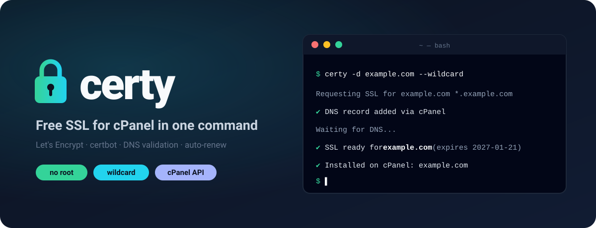

<p align="center"></p>

# certy

Free SSL certificates (Let's Encrypt) with a single command — on any Linux server, with or without root, including cPanel accounts with only a jailed shell. Powered by `certbot`.

```bash
certy -d example.com --wildcard
```

- **Runs anywhere**: VPS or dedicated server (root or not) and shared cPanel hosting, even in a jailed shell.
- **No root required**: everything is installed into `~/bin` and `~/.certy`; with root, certbot can come from the OS package manager.
- **Bundled certbot**: a standalone certbot binary is built with GitHub Actions and published in Releases (no Python needed).
- **Always DNS validation (DNS-01)**: TXT records are added and removed automatically (cPanel `uapi` or Cloudflare API) and shown in a clean table.
- **Cloudflare**: save one or more Cloudflare API tokens with `certy cloudflare`; for domains on Cloudflare certy shows the record and asks whether to add it automatically or by hand.
- **Manual fallback**: for any other DNS provider, certy prints the records, waits for you to type `DONE`, checks DNS itself and tells you which record is still missing.
- **Automatic renewal** via cron, and **automatic install** into cPanel when it runs there.

## Install

On your server or cPanel host (SSH or cPanel Terminal):

```bash
curl -fsSL https://raw.githubusercontent.com/s7net/certy/main/install.sh | bash
```

If you have root access and want certbot installed from the OS package manager:

```bash
curl -fsSL https://raw.githubusercontent.com/s7net/certy/main/install.sh | bash -s -- --root
```

If neither `--root` nor `--user` is given, the installer asks.

## Usage

Just run `certy` - it asks for the domain, wildcard and verification type:

```
$ certy
                 _
   ___ ___ _ __| |_ _   _
  / __/ _ \ '__| __| | | |
 | (_|  __/ |  | |_| |_| |
  \___\___|_|   \__|\__, |
                    |___/  free SSL, anywhere

Domain: example.com
Include wildcard (*.example.com)? [y/N]: y
Verification:
  1) Automatic (cPanel DNS)
  2) Manual (I add the DNS record)
Choose [1]: 1

Requesting SSL for example.com *.example.com
✔ DNS record added in cPanel
Waiting for DNS...
✔ SSL ready for example.com (expires 2027-01-21)
✔ Installed on cPanel: example.com, shop.example.com
```

With manual verification (or when the zone isn't on this cPanel) certy shows the record, a direct Cloudflare link if the domain uses Cloudflare, and waits for `DONE`:

```
Add this TXT record to your DNS:
┌─────────────────────────────┬──────┬─────────────────────────────────────────────┐
│ Name                        │ Type │ Value                                       │
├─────────────────────────────┼──────┼─────────────────────────────────────────────┤
│ _acme-challenge.example.com │ TXT  │ _zV17C9bJwIfgxVRd5E52ppayU_I1eoDj-obXR1HKDA │
└─────────────────────────────┴──────┴─────────────────────────────────────────────┘
Cloudflare: https://dash.cloudflare.com/?to=/:account/example.com/dns/records
Type DONE when the record is set (ABORT to cancel):
```

Or without questions:

```bash
certy -d example.com --wildcard
certy -d example.com,www.example.com --manual
```

### Managing certificates

Running `certy` when certificates exist offers **Manage SSLs**: pick one to renew, re-install on cPanel, show its files or delete it. The same actions as commands:

| Command | Description |
|---|---|
| `certy list` | Certificates with domains, expiry date and days left |
| `certy renew [NAME]` | Renew due certificates (runs daily from cron automatically) |
| `certy install NAME` | Install a certificate on its cPanel domains |
| `certy show NAME` | Show certificate file paths |
| `certy delete NAME` | Delete a certificate |
| `certy cloudflare` | Manage Cloudflare API tokens: list (masked, with zones and date), add, edit, delete |
| `certy update` | Update certy and certbot (with download progress) |

| Option | Description |
|---|---|
| `-d, --domain` | Domain to include (repeatable or comma separated) |
| `-w, --wildcard` | Also include `*.domain` for each domain |
| `-e, --email` | Let's Encrypt account email (remembered) |
| `--manual` | Add the DNS record yourself; certy waits for `DONE` and verifies |
| `--no-install` | Don't install the certificate into cPanel |
| `--staging` | Use the Let's Encrypt staging server |
| `--force` | Re-issue even if the current certificate is still valid |

Certificates are stored in `~/.certy/config/live/<name>/`. `CERTY_DNS_TIMEOUT` (default 300s) is the maximum wait for automatic DNS records.

## Building the certbot binary

The [`.github/workflows/release.yml`](.github/workflows/release.yml) workflow runs on every `v*` tag (or manually). It builds certbot with PyInstaller inside a `manylinux2014` container for `x86_64` and `aarch64` (compatible with CentOS 7 / CloudLinux and newer) and uploads it to the Release:

```bash
git tag v1.0.1 && git push origin v1.0.1
```

If the binary doesn't run on a server, the installer automatically falls back to installing certbot in a Python virtualenv.

## License

MIT
